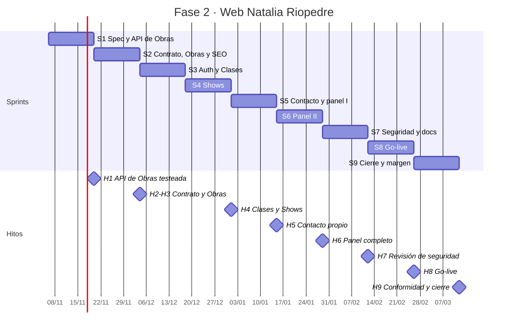

# Plan de gestión del proyecto · Web Natalia Riopedre

| | |
|---|---|
| **Proyecto** | Fase 2 del sitio de Natalia Riopedre: backend, panel de administración y cierre |
| **Cliente** | Natalia Riopedre (bailaora, coreógrafa y docente de flamenco) |
| **Responsable** | Eugenia Demarchi · gestión, análisis y desarrollo |
| **Metodología** | Scrum adaptado a una persona, sprints de 2 semanas |
| **Sitio** | [nataliariopedre.com](https://nataliariopedre.com) |
| **Tablero** | [Jira · proyecto NR](https://demarchieugenia23.atlassian.net/jira/software/projects/NR/boards/1) |
| **Especificación** | [`docs/especificacion-api.md`](especificacion-api.md) |
| **Versión del plan** | 1.4 · 06/11/2026 |

> Documento vivo, versionado junto al código (docs-as-code). Enlaza a Jira y a la
> especificación en lugar de copiarlas, para que no haya dos versiones de lo mismo.

---

## 1. Alcance

### Objetivo general
Que Natalia administre por su cuenta el contenido de su sitio (obras, clases, shows y
mensajes de contacto), sin depender de una desarrolladora y sin costo de infraestructura,
y que su sitio sea encontrado por quienes buscan flamenco en Buenos Aires.

### Objetivos específicos (SMART)
| ID | Objetivo | Medida | Fecha |
|---|---|---|---|
| OE-1 | Natalia crea, edita y borra obras, clases y shows desde el panel | 100 % de los criterios de aceptación de las historias del panel aprobados en UAT | 12/03/2027 |
| OE-2 | Los mensajes de contacto quedan registrados en la base del proyecto | 0 mensajes perdidos en las pruebas de aceptación; Formspree dado de baja | 15/01/2027 |
| OE-3 | La API es confiable y mantenible | 100 % de los endpoints con tests automáticos que cubren sus criterios de aceptación | 12/03/2027 |
| OE-4 | El sitio mantiene su calidad actual | Lighthouse mobile ≥ 90 en Performance y ≥ 95 en Accesibilidad, Buenas prácticas y SEO en todas las páginas | 12/03/2027 |
| OE-5 | Costo de infraestructura cero, de forma permanente | Toda la infraestructura dentro de planes gratuitos; consumo de cada proveedor por debajo del 70 % de su límite, revisado una vez por mes. Única excepción: el dominio (ver restricciones) | Desde el go-live (26/02/2027) y en adelante |
| OE-6 | El sitio aparece cuando se busca a Natalia o flamenco en Buenos Aires | Según Google Search Console: 1.ª posición para "Natalia Riopedre"; primera página para "bailaora de flamenco Buenos Aires" y para "clases de flamenco" + barrio de cada sede | Marca: 31/12/2026 · búsquedas genéricas: 30/06/2027 |

### Inclusiones y exclusiones
| Incluido (MVP) | Excluido |
|---|---|
| API REST de Obras, Clases y Shows con alta, edición y baja | Edición de la Bio y de la introducción de Clases (fase 2) |
| Subida de imágenes a Cloudinary | Lista reutilizable de Espacios (fase 2) |
| Usuario administrador único, login y recuperación de contraseña | Registro público de usuarios o múltiples roles |
| Backend propio para Contacto (guardado + aviso por email + anti-spam) | Envío de newsletters o mensajes masivos |
| Panel de administración usable desde el celular | App móvil nativa |
| Posicionamiento orgánico: SEO técnico, datos estructurados, Search Console y Google Business Profile | Publicidad paga (Google Ads, redes) y gestión continua de SEO o contenidos después del cierre |
| Deploy, manuales y traspaso de cuentas | **Mantenimiento posterior a la entrega** |

### Entregables
| Tipo | Entregable |
|---|---|
| Externo (para Natalia) | Contrato de servicio firmado (al inicio) · Sitio en producción con panel de administración · Manual de usuario (PDF) + guía rápida · Acta de traspaso del dominio y las cuentas · Acta de conformidad (sign-off) |
| Interno (para el proyecto) | Especificación de la API · Este plan de gestión · Tests automatizados · Manual técnico y guía de instalación · Informe final y lecciones aprendidas |

### Control de cambios (prevención del *scope creep*)
Todo pedido nuevo se registra en Jira como incidencia dentro de la épica **Phase 2** y se
evalúa antes de aceptarlo: impacto en puntos, sprint afectado y qué se posterga a cambio.
Solo entra al MVP si Natalia y la responsable lo aprueban; la decisión queda registrada en
la incidencia y, si cambia el plan, en el historial de este documento.

---

## 2. Interesados

| Interesado | Tipo | Interés | Influencia | Estrategia |
|---|---|---|---|---|
| Natalia Riopedre | Externo · cliente y usuaria del panel | Alto: autonomía para publicar | Alta: valida requisitos y acepta el producto | Demo al cierre de cada sprint · validación de la especificación · UAT |
| Eugenia Demarchi | Interno · gestión y desarrollo | Alto: entrega de calidad y pieza de portfolio | Alta | Este plan, Jira y la Definición de Terminado |
| Visitantes del sitio (alumnas, público, programadores de salas) | Externo · usuarios finales | Medio: información actual de clases y shows | Baja (indirecta) | Criterios de aceptación orientados a ellos · Lighthouse |
| Futura persona desarrolladora | Externo · mantenimiento eventual | Medio: entender y modificar el sistema | Baja hoy, alta a futuro | Manual técnico, convenciones del README, ADR |
| Proveedores (Netlify, MongoDB Atlas, Cloudinary, servicio de email) | Externo | — | Media: sus límites gratuitos condicionan el proyecto | Monitoreo de cuotas (ver riesgos R1–R3) |

---

## 3. Requerimientos

La especificación detallada (modelos, endpoints, criterios de aceptación) está en
[`especificacion-api.md`](especificacion-api.md). Acá se resume el catálogo, su
prioridad y su trazabilidad hacia Jira.

| ID | Requerimiento | Tipo | MoSCoW | Épica |
|---|---|---|---|---|
| RF-01 | Gestionar obras (alta, edición, baja, imágenes) | Funcional | Must | NR-8 |
| RF-02 | Gestionar clases y sus horarios (alta, edición, baja, imágenes) | Funcional | Must | NR-9 |
| RF-03 | Gestionar shows (alta, edición, baja, imágenes); ocultar automáticamente los pasados | Funcional | Must | NR-10 |
| RF-04 | Recibir y guardar mensajes de contacto, con aviso por email | Funcional | Must | NR-11 |
| RF-05 | Iniciar y cerrar sesión como administradora | Funcional | Must | NR-1 |
| RF-06 | Recuperar la contraseña por email | Funcional | Should | NR-1 |
| RF-07 | Leer los mensajes desde el panel | Funcional | Should | NR-12 |
| RF-08 | Editar Bio e introducción de Clases | Funcional | Won't (esta fase) | NR-14 |
| RNF-01 | Solo la administradora puede modificar contenido; contraseña con hash; sesión en cookie `httpOnly` | No funcional · seguridad | Must | NR-1 |
| RNF-02 | Máximo 5 intentos de login cada 15 minutos por IP | No funcional · seguridad | Must | NR-1 |
| RNF-08 | Doble factor y bloqueo del dominio en todas las cuentas; cabeceras de seguridad; auditoría de dependencias; backup semanal de la base; registro de actividad del panel; revisión OWASP Top 10 documentada | No funcional · seguridad | Must | NR-1 |
| RNF-03 | El panel se usa completo desde un celular de 320 px y con teclado | No funcional · usabilidad | Must | NR-12 |
| RNF-04 | Lighthouse mobile ≥ 90 / 95 / 95 / 95 | No funcional · rendimiento y calidad | Should | NR-13 |
| RNF-05 | Los cambios de Natalia se ven sin un nuevo deploy | No funcional · operación | Must | todas |
| RNF-06 | Costo de infraestructura $0 (salvo el dominio) | Restricción | Must | NR-7 |
| RNF-07 | Cada página tiene título, descripción, `<h1>` propio en el HTML y URL canónica; el sitio publica `robots.txt`, `sitemap.xml` y datos estructurados (Person, Event, cursos) | No funcional · SEO | Must | NR-44 |
| RD-01 | Fechas de shows en formato ISO y hora de Buenos Aires | Dominio | Must | NR-10 |
| RD-02 | Niveles de clase: inicial, intermedio bajo, intermedio, intermedio alto, avanzado | Dominio | Must | NR-9 |

**Validación:** la especificación se revisa con Natalia antes de implementar cada módulo
("¿estamos construyendo el producto correcto?"). Tarea NR-15.

---

## 4. Riesgos, supuestos y restricciones

### Riesgos
Probabilidad e impacto: Baja / Media / Alta.

| ID | Riesgo | Prob. | Impacto | Respuesta |
|---|---|---|---|---|
| R1 | Se agotan los 300 créditos mensuales de Netlify y se pausa el sitio | Media | Alto | Desarrollar en ramas (los deploys de rama son gratuitos) · imágenes en Cloudinary · revisar el consumo semanalmente · sitio en una cuenta propia de Natalia |
| R2 | MongoDB Atlas elimina el cluster gratuito por inactividad | Baja | Alto | El tráfico del sitio lo mantiene activo · exportación periódica de la base · script de seed versionado |
| R3 | Se supera la cuota gratuita de Cloudinary o del servicio de email | Baja | Medio | Límite de tamaño de imagen (10 MB) · monitoreo de cuotas · los mensajes se guardan aunque falle el email |
| R4 | La estimación es optimista (primer proyecto con backend propio) | Alta | Medio | Recalibrar la velocidad al cerrar cada sprint · las historias "Should" se postergan antes que la calidad |
| R5 | Baja disponibilidad de Natalia para validar | Media | Medio | Validaciones cortas y agendadas al cierre de cada sprint · preguntas por escrito con opciones |
| R6 | Natalia no logra usar el panel sola (contradice la restricción de cero mantenimiento) | Media | Alto | UAT con ella como usuaria real · manual paso a paso con capturas · recuperación de contraseña |
| R7 | Ataque o usurpación: acceso no autorizado al panel, robo de una cuenta o secuestro del dominio | Baja | Alto | Endpoints protegidos y testeados · doble factor y bloqueo del dominio · cabeceras de seguridad · backups · registro de actividad · revisión OWASP documentada en `docs/seguridad.md` (evidencia de debida diligencia) · cláusula de responsabilidad en el contrato (NR-50) |
| R8 | Feriados de diciembre y enero reducen la capacidad | Alta | Bajo | Sprint 4 planificado con menos puntos |
| R10 | El dominio `nataliariopedre.com` vence: está registrado en la cuenta de GoDaddy de la desarrolladora y pagado por un año | Media | Alto | Transferir el dominio a una cuenta de Natalia con renovación automática antes del cierre (NR-40) · recordatorio un mes antes del vencimiento |
| R11 | El posicionamiento depende de factores externos (algoritmo de Google, competencia, enlaces) y tarda meses | Alta | Medio | Metas por tipo de búsqueda y plazos realistas · medición con Search Console · Google Business Profile para las búsquedas locales |
| R9 | Deuda técnica planificada: `render-shows.ts`, `contacto.ts` y `render-obras.ts` todavía no siguen las convenciones del proyecto; podría quedar sin resolver si se aprieta el cronograma | Media | Bajo | Refactor incluido como criterio de aceptación en NR-21, NR-28 y NR-30: por la DoD, esas historias no se cierran sin él. Se pospone a propósito, porque esos archivos se reescriben al conectarse con la API |

### Supuestos
| ID | Supuesto | Si no se cumple… |
|---|---|---|
| S1 | Natalia está disponible para una validación por sprint | → se convierte en R5 y frena la aceptación |
| S2 | Los planes gratuitos mantienen sus condiciones actuales | → R1–R3 se materializan; hay que reevaluar el costo |
| S3 | El contenido actual (8 obras, 5 clases) sirve como datos iniciales | → hay que relevar contenido nuevo antes del deploy |

### Restricciones
- **Costo:** proyecto pro-bono; la infraestructura tiene que ser gratuita. **Única excepción decidida:** el dominio `nataliariopedre.com` (registro anual), porque mejora el posicionamiento y la imagen profesional. Su renovación pasa a ser responsabilidad de Natalia.
- **Cero mantenimiento posterior:** todo tiene que poder operarlo Natalia sola.
- **Una sola persona** para gestión, análisis, desarrollo y pruebas.
- **Stack:** TypeScript en frontend y backend, alojamiento en Netlify.

*Ejemplo de la cadena:* si no se cumple S2 (Netlify reduce su plan gratuito), aparece R1
(el sitio se pausa), y la restricción de costo cero limita la respuesta posible: no se
puede pasar a un plan pago, hay que reducir el consumo o migrar de proveedor.

---

## 5. Estimación

- **Técnica:** puntos de historia con escala Fibonacci (1, 2, 3, 5, 8), por comparación
  entre historias. Una historia de 8 o más se divide antes de entrar a un sprint.
- **Tamaño del MVP:** **116 puntos** en 9 épicas (fase 2 sin estimar, fuera de alcance). Pasó de 96 a 106 con CR-01 (posicionamiento), a 107 con CR-02 (contrato al inicio) y a 116 con CR-03 (seguridad).
- **Velocidad inicial supuesta:** 16 puntos por sprint. Al no haber historial, es un
  supuesto que se recalibra con la velocidad real de cada sprint (ver sección 8).
- **PERT sobre la tarea más incierta**, el login seguro (NR-2), por ser la primera vez
  que se implementa autenticación con JWT:
  O = 2 días · M = 4 días · P = 8 días → **E = (2 + 4·4 + 8) / 6 = 4,3 días**.
- **Costo:** infraestructura $0 (planes gratuitos). Único costo: el dominio
  `nataliariopedre.com`, de pago anual; el primer año ya está pago.

---

## 6. Planificación

### Plan de releases
| Sprint | Fechas | Objetivo del sprint | Puntos |
|---|---|---|---|
| 1 | 06/11 – 20/11 | La API de Obras funciona en local, con tests, sobre una especificación completa; cuentas protegidas con doble factor | 17 |
| 2 | 20/11 – 04/12 | Contrato firmado; Obras completo (sitio, imágenes y login) y bases técnicas de SEO publicadas | 17 |
| 3 | 04/12 – 18/12 | Autenticación completa, módulo de Clases y alta en Search Console | 16 |
| 4 | 18/12 – 01/01 | Módulo de Shows con sus eventos visibles en Google; auditoría de dependencias (capacidad reducida por feriados) | 13 |
| 5 | 01/01 – 15/01 | Contacto propio, pantalla de login del panel, datos estructurados y backups de la base | 15 |
| 6 | 15/01 – 29/01 | Formularios del panel para Obras, Clases y Shows | 15 |
| 7 | 29/01 – 12/02 | Seguridad y documentación técnica: registro de actividad, cabeceras, revisión OWASP, bandeja de mensajes, revisión de contenidos | 12 |
| 8 | 12/02 – 26/02 | Go-live: deploy a producción, manual de usuario y auditoría Lighthouse | 8 |
| 9 | 26/02 – 12/03 | Cierre: traspaso del dominio y las cuentas, UAT y conformidad; el resto de la capacidad es margen para desvíos | 3 |

### Hitos (SMART)
| ID | Hito | Fecha |
|---|---|---|
| H1 | API de Obras con el 100 % de sus escenarios de aceptación automatizados y en verde, y especificación validada por Natalia | 20/11/2026 |
| H2 | Contrato de servicio firmado por ambas partes, revisado por un abogado | 04/12/2026 |
| H3 | Obras gestionables de punta a punta con escritura protegida por login, y SEO técnico publicado | 04/12/2026 |
| H4 | Clases y Shows servidos desde la API, con tests en verde | 01/01/2027 |
| H5 | Formspree dado de baja; 0 mensajes perdidos en las pruebas | 15/01/2027 |
| H6 | Panel completo usable desde el celular | 29/01/2027 |
| H7 | Revisión OWASP Top 10 sin hallazgos críticos ni altos abiertos, documentada en `docs/seguridad.md` | 12/02/2027 |
| H8 | Go-live: sitio con backend en producción y manual de usuario entregado | 26/02/2027 |
| H9 | Acta de conformidad firmada por Natalia, dominio y cuentas traspasados (cierre) | 12/03/2027 |

### Cronograma

### Camino crítico
Contrato firmado → especificación → setup del backend → API de Obras → autenticación → panel de
administración → revisión de seguridad → deploy → UAT. Cualquier atraso en esta cadena mueve la fecha de cierre.
Contacto, SEO y la auditoría Lighthouse tienen holgura: pueden correrse dentro de su
sprint sin afectar la entrega. El sprint 9 funciona como reserva para absorber desvíos.

El SEO técnico se adelanta a propósito al sprint 2, aunque no esté en el camino crítico:
Google tarda semanas o meses en indexar y posicionar, así que cuanto antes empiece, antes
se cumple OE-6.

---

## 7. Proceso de trabajo

### Scrum adaptado a una persona
| Elemento | Adaptación |
|---|---|
| Product Owner | Eugenia, como representante de Natalia; Natalia valida y acepta |
| Scrum Master y equipo | Eugenia |
| Sprint Planning | Al inicio de cada sprint: objetivo, historias que cumplen la Definición de Listo, capacidad |
| Daily | Nota breve de avance y bloqueos en la historia activa de Jira |
| Sprint Review | Demo a Natalia del incremento; su devolución entra al backlog |
| Retrospectiva | Registro en la sección 8: qué funcionó, qué no, una mejora concreta |
| Refinamiento | Antes de cada planning: criterios de aceptación y estimación de las próximas historias |

### Definición de Listo (DoR)
Una historia entra a un sprint solo si:
- Está escrita como historia de usuario y cumple INVEST.
- Tiene criterios de aceptación verificables (Given / When / Then o checklist).
- Está estimada (8 puntos o menos).
- Su sección de la especificación está escrita y validada.
- Sus dependencias están terminadas o planificadas antes.

### Definición de Terminado (DoD)
Una historia está terminada solo si:
- Cumple todos sus criterios de aceptación.
- Cada criterio tiene un test automático, y todos los tests pasan.
- `npm run typecheck` pasa sin errores y `npm audit` no reporta vulnerabilidades altas ni críticas.
- Si toca el frontend: se verificó en todos los breakpoints (320 a 1920 px).
- La especificación y la documentación están actualizadas en el mismo PR.
- Se integró a `main` mediante un pull request que referencia la incidencia.

### Flujo del tablero

*In Review* = pull request abierto y revisión contra la DoD antes de integrar.

### Gestión de la configuración
| Elemento | Convención |
|---|---|
| Ramas | Una por incidencia: `NR-19-api-obras-lectura`. `main` solo recibe cambios por PR |
| Commits | Conventional Commits con la clave: `feat(obras): agregar GET /api/obras NR-19` |
| Pull requests | Título con la clave; plantilla con la DoD como checklist |
| Trazabilidad | GitHub conectado a Jira: ramas, commits y PRs aparecen en cada incidencia |
| Versiones | SemVer; `v1.0.0` en el go-live, con su release en Jira |
| Secretos | Solo en `.env` (fuera de Git) y en variables de entorno de Netlify; `.env.example` versionado |

### Uso de IA
Se usa IA como asistente para revisar código, redactar borradores de especificación y de
historias, y detectar ambigüedades. Toda salida se valida antes de incorporarla: la IA
aporta borradores y patrones; las decisiones, el contexto y la responsabilidad son de la
responsable del proyecto.

---

## 8. Seguimiento y control

### Indicadores (KPIs)
| KPI | Qué mide | Fuente | Meta |
|---|---|---|---|
| Velocidad | Puntos terminados por sprint | Informe de velocidad de Jira | Estable (±20 %) a partir del sprint 3 |
| Burndown | Trabajo pendiente dentro del sprint | Jira | Sin desvíos sostenidos sobre la línea ideal |
| Cycle time | Días desde *In Progress* hasta *Done* | Jira | ≤ 4 días por historia |
| Cumplimiento del objetivo de sprint | Sprints que cumplen su objetivo | Registro de sprints | ≥ 80 % |
| Frecuencia de deploy (DORA) | Deploys a producción por sprint | Netlify | ≥ 1 a partir del sprint 2 |
| Tasa de fallos de cambio (DORA) | Deploys que requieren corrección | Netlify + Jira | ≤ 15 % |
| Calidad | Tests en verde · Lighthouse | CI local · Lighthouse | 100 % · metas de OE-4 |
| Posicionamiento | Posición media y clics por búsqueda objetivo | Google Search Console | Las metas de OE-6 |
| Consumo de cuotas | Créditos de Netlify y uso de Atlas y Cloudinary | Paneles de cada proveedor | < 70 % del límite |

### Semáforo de estado
- 🟢 **Verde:** el objetivo del sprint se cumple y no hay riesgos activos de impacto alto.
- 🟡 **Amarillo:** desvío menor al 20 % en puntos, o un riesgo de impacto alto activo con mitigación en curso.
- 🔴 **Rojo:** el objetivo del sprint no se cumple, o se compromete un hito. Requiere replanificación.

### Registro de sprints
| Sprint | Objetivo cumplido | Comprometido | Terminado | Estado | Retrospectiva: una mejora |
|---|---|---|---|---|---|
| 1 | — | 17 | — | — | — |

---

## 9. Documentación y artefactos

| Artefacto | Ubicación | Audiencia |
|---|---|---|
| README (punto de entrada) | `README.md` | Cualquier persona que llega al repo |
| Especificación de la API | `docs/especificacion-api.md` | Desarrollo |
| Plan de gestión | `docs/plan-de-gestion.md` | Gestión, cliente, evaluación |
| Manual técnico, guía de instalación y ADR | `docs/` (NR-38) | Futura persona desarrolladora |
| Medidas de seguridad y revisión OWASP (evidencia de debida diligencia) | `docs/seguridad.md` (NR-56) | Gestión, cliente, evaluación |
| Manual de usuario y guía rápida | PDF entregado a Natalia (NR-37) | Natalia |
| Tests | `server/tests/` | Desarrollo |
| Backlog, sprints e historial | Jira, proyecto NR | Gestión |

Toda la documentación técnica sigue el enfoque docs-as-code: Markdown en el repositorio,
diagramas en Mermaid, cambios revisados en el mismo pull request que el código.
Criterio de calidad: las 4 C (clara, concisa, correcta y completa).

---

## 10. Cierre

Detallado en la incidencia NR-41:
1. **UAT:** guion derivado de los criterios de aceptación; Natalia lo ejecuta en producción.
2. **Conformidad:** acta firmada por Natalia.
3. **Traspaso:** dominio, cuentas y accesos a nombre de Natalia, con renovación automática del dominio (NR-40). El contrato de servicio ya se firmó al inicio (NR-50).
4. **Informe final:** planificado vs. real (alcance, sprints, velocidad, KPIs) y causas de los desvíos.
5. **Lecciones aprendidas:** qué repetir y qué evitar en el próximo proyecto.

---

## Registro de solicitudes de cambio
| ID | Fecha | Solicitud | Impacto evaluado | Decisión |
|---|---|---|---|---|
| CR-01 | 06/11/2026 | Posicionar el sitio en Google para búsquedas de flamenco en Buenos Aires | +10 puntos (épica NR-44) · +1 sprint · cierre del 12/02 al 26/02/2027 · nuevo costo: dominio anual | Aprobada |
| CR-02 | 06/11/2026 | Firmar el contrato de servicio al inicio y no al cierre, como línea base del alcance y protección ante incidentes de seguridad de terceros | Contrato separado del traspaso (NR-50, 2 puntos; NR-40 baja a 1) · +1 punto · Search Console pasa del sprint 2 al 3 · sin cambio de fechas | Aprobada |
| CR-03 | 06/11/2026 | Aplicar buenas prácticas de seguridad como cobertura ante ataques y usurpación, y como evidencia de debida diligencia | +9 puntos (NR-51 a NR-56) · +1 sprint · go-live del 12/02 al 26/02 y cierre del 26/02 al 12/03/2027 | Aprobada |

## Historial de cambios
| Versión | Fecha | Cambio |
|---|---|---|
| 1.0 | 06/11/2026 | Versión inicial: alcance, interesados, requerimientos, riesgos, estimación, plan de releases, proceso, KPIs y cierre |
| 1.1 | 06/11/2026 | Se agrega R9 (deuda técnica planificada en Shows, Contacto y Obras) |
| 1.2 | 06/11/2026 | CR-01: objetivo OE-6 de posicionamiento, épica NR-44, dominio propio como excepción de costo, riesgos R10 y R11, plan de 8 sprints con cierre el 26/02/2027 |
| 1.3 | 06/11/2026 | CR-02: contrato firmado al inicio (hito H2), traspaso de cuentas al cierre |
| 1.4 | 06/11/2026 | CR-03: medidas de seguridad (RNF-08, R7 ampliado, hito H7), plan de 9 sprints con go-live el 26/02 y cierre el 12/03/2027 |
